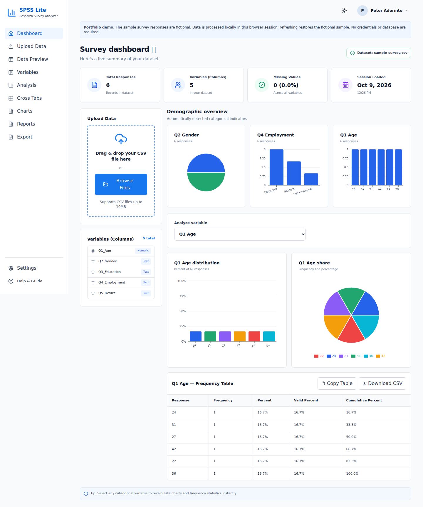
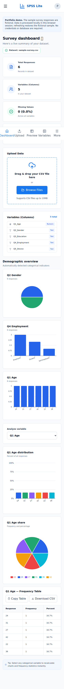

# SPSS Lite

A portfolio demo for exploring survey responses in the browser. Open it with
six fictional sample records already loaded, or upload a CSV to see its
frequencies, charts, missing values, and cross-tabulations. No credentials,
external database, or backend setup is required.

## Screenshots

Captured from the actual local production build with the fictional sample.





## Features

- Automatically loaded fictional survey with a visible portfolio-demo notice.
- CSV upload, with a header row, consistent columns, and a 10MB limit; invalid
  files show an error while preserving the currently loaded dataset.
- Dataset counts, missing-value summaries, variable type inference, and
  searchable raw records.
- Categorical frequency tables with overall percentages, valid percentages,
  cumulative percentages, and responsive bar/pie charts.
- Two-variable cross-tabulation, dataset summary cards, CSV dataset/frequency
  downloads, and clipboard table copying with success/failure feedback.
- Desktop navigation and a mobile menu with keyboard focus handling and Escape.

## Stack and local setup

React 19, Vite 8, Tailwind CSS 4, Papa Parse, Recharts, and Lucide icons.
JavaScript/JSX source uses Oxlint; npm and the checked-in lockfile preserve
reproducible dependency installation. Use **Node.js 24.x** for local development
and Vercel builds.

```sh
npm ci
npm run dev
```

Open the URL printed by Vite. To build and preview:

```sh
npm run build
npm run preview
```

## Architecture and data behavior

`src/App.jsx` owns the active view and dataset in React state. The six-row
sample is seeded on every fresh page load. CSV parsing uses Papa Parse's
file-reading callback; analysis runs directly on the parsed records in memory.
`src/components/frequencyUtils.js` computes the categorical summaries, while
`DynamicAnalysis.jsx` connects those results to tables and Recharts.
The views in `src/components/views/` share the same dataset.

This project has **no payment service, invoice workflow, or simulated
asynchronous payment API**. It makes no real HTTP payment requests. CSV file
reading completes asynchronously through Papa Parse, but is local file
processing, not a simulated network service.

Uploaded datasets stay in the current browser session's React state. They
are not uploaded to a server or saved to localStorage; refreshing restores
the fictional sample. There are no created invoices to persist. More generally,
browser storage is origin-specific: data saved by an app on localhost would
not automatically appear on its deployed domain.

There is no fixed historical demo date in this survey app. The **Session
Loaded** card records when the current sample or uploaded dataset was loaded,
not a survey collection date. Demo profile, light appearance, variable editing,
and settings preferences are explicitly informational or disabled controls.

## Verification

```sh
npm run lint
npm test
npm run build
npm audit
npm audit --omit=dev
```

The Node test suite checks frequency denominators, missing data, zero/false
responses, empty datasets, and categorical detection. There is no TypeScript
configuration or typecheck script in this JavaScript project; no TypeScript
verification is claimed.

To verify a production build without replacing a local preview's `dist/`:

```sh
npm run build -- --outDir .dist-verify
npm run preview -- --outDir .dist-verify --port 4178 --strictPort
```

That directory override is for local verification only. Vercel uses the
normal `dist/` output configured in `vercel.json`.

The release was checked in Chromium: fictional sample loading, navigation
through every view, row search, CSV download, invalid and valid uploads,
refresh behavior, mobile navigation, Escape dismissal, and page overflow at
320, 375, 768, and 1440 pixels. No browser console or page errors were observed
in those checks. These checks do not establish full accessibility conformance.

## Deployment

Deploy as a static **Vite** project, using Node.js **24.x**, repository root `.`,
`npm ci`, `npm run build`, and output directory `dist`. No environment variables,
payment credentials, database provisioning, or paid services are required.

## Limitations and dependencies

This is a descriptive-analysis portfolio demo, not IBM SPSS or a validated
statistical package. It has no inferential tests, persistent datasets, invoice
or payment functionality, chart-image export, or report-document generation.
Settings controls do not change analysis. Numeric variables with few distinct
values are treated as categorical. A literal response named `Missing` shares
the display label used for missing cells; CSV exports may need care before
opening arbitrary untrusted values in spreadsheet software. The synchronous
analysis may become slow for large datasets even within the upload limit.

The initial audit found two high-severity build-tool dependency advisories.
Compatible lockfile updates fixed both; the full and production-filtered
reports then showed zero vulnerabilities. See the [dependency review](docs/dependency-review.md)
for the packages, dependency paths, practical exposure, and review date.
The production bundle still triggers Vite's size warning (about 645KB before
gzip); no broad code-splitting rewrite was made during this release review.
